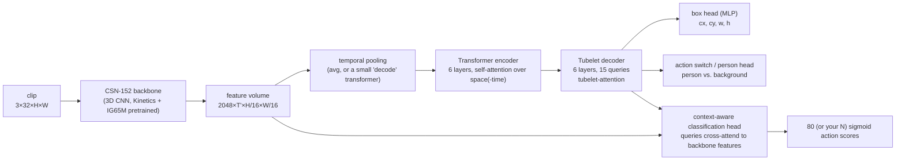

# 1. TubeR, explained

## 1.1 The task: spatio-temporal action detection

Image classification asks *what* is in a picture, and object detection adds *where*. **Spatio-temporal
action detection** (also called *action localisation*) answers **who is doing what, where, and when** in
a video:

- **Where:** a bounding box around each person.
- **What:** one or more action labels per person. It is *multi-label*: someone can `walk` and
  `talk_to_person` at the same time.
- **When:** the answer changes over time. A sequence of boxes that follows one person is called a
  **tubelet** (a short "tube" through space-time).

A single frame is often ambiguous. Is a person with a raised leg walking, running, kicking or falling?
You need motion, so these models look at a **clip** (TubeR uses 32 frames ≈ 2 s) and predict for its
**key frame** (the middle one).

The standard benchmark is **AVA** (Atomic Visual Actions): 430 fifteen-minute movie clips, with people
boxed once per second (the key frames) and labelled with 80 atomic actions, 60 of which are evaluated.
The metric is **frame-mAP@0.5**. A detection counts as correct if its box overlaps a ground-truth box of
the same action with IoU ≥ 0.5. Average precision is computed per action class, then averaged. For
reference, TubeR's released models reach 27–31 mAP on AVA. AVA is hard, and 30 is a good number there.

## 1.2 How things were done before TubeR: two-stage

```
clip ──► off-the-shelf person detector (Faster R-CNN) on the key frame ──► boxes
clip ──► 3D CNN (SlowFast, I3D...) ──► feature volume ──► RoI-Align(boxes) ──► classifier ──► actions
```
This works well (SlowFast, VideoMAE and most AVA leaderboard entries do it), but:
- it needs two models and two trainings, with the person detector frozen and trained elsewhere;
- the classifier only sees the feature inside each box (plus whatever context you engineer in);
- the box is fixed across the whole clip, even though people move.

## 1.3 TubeR's idea: DETR for video

[DETR](https://arxiv.org/abs/2005.12872) (Carion et al., 2020) showed that object detection can be framed
as **set prediction**. A transformer decoder takes N learned **queries**; each query either outputs one
object or says "no object". During training, predictions are matched one-to-one to ground-truth objects with
the **Hungarian algorithm**, so no anchors and no non-maximum suppression are needed.

TubeR brings this to video: each **tubelet query** is responsible for one person over the clip, and outputs
that person's box (per frame, or on the key frame in AVA mode) and their actions.



### The pieces, and where they live in the code

| Paper component | What it does | Code (`third_party/tubelet-transformer/`) |
|---|---|---|
| Backbone | 3D CNN (channel-separated network, CSN-152 or CSN-50) turns the clip into a feature volume | `models/backbones/ir_CSN_152.py` |
| Temporal down-sampling | AVA mode predicts only for the key frame, so the time axis is pooled: `avg`, `max`, or `decode` (a 1-layer transformer decoder with one learned query) | `models/backbone_builder.py` |
| Encoder | DETR-style self-attention over the feature map, with positional encodings | `models/transformer/transformer.py` |
| Tubelet queries | `query_embed`: QUERY_NUM learned vectors (15 for AVA; QUERY_NUM × T for full tubelets on JHMDB/UCF) | `models/tuber_ava.py` (`DETR.__init__`) |
| Tubelet attention | In the paper, decoder queries first attend to each other *spatially* (within a frame) and *temporally* (the same person across frames), then cross-attend to the encoder memory. **In the released code** the decoder layer is a standard DETR layer: one self-attention over *all* queries jointly, then cross-attention. It is functionally a joint space-time version (see upstream issue #26, "Code here don't match the paper") | `models/transformer/transformer.py` (`TransformerDecoderLayer`) |
| Box head | 3-layer MLP → sigmoid → normalised (cx, cy, w, h) | `bbox_embed` |
| Action switch / person head | `class_embed_b`. On AVA it's a 3-way softmax where index 1 = "this query is a person" and the last index = "no object". On JHMDB it decides per frame whether the action is still going on, which is how tubelets get variable length | `class_embed_b` |
| Context-aware classification head | Queries **cross-attend to the full backbone feature volume** (after `class_proj` and a 1-layer encoder), so the action classifier sees scene context and not just the box. The long-term variant adds a memory bank of features from the past minutes (not released) | `class_proj`, `encoder`, `cross_attn`, `class_fc` |

### Training: matching and losses

For each clip:
1. **Hungarian matching** (`models/detr/matcher.py`). Cost = 5·L1(box) + 2·(−GIoU) + 12·(−P(person)).
   This assigns each ground-truth person to exactly one query. Unmatched queries learn "no object".
2. **Losses** (`models/criterion.py`, `SetCriterionAVA`):
   - `loss_ce_b`: person-vs-background cross-entropy, with "no object" down-weighted by `EOS_COF = 0.1`
     because most queries are empty;
   - `loss_ce`: per-action binary cross-entropy (multi-label), with matched queries up-weighted ×10;
   - `loss_bbox` (L1) and `loss_giou` for the matched queries only;
   - the same losses on every decoder layer (**auxiliary losses**), a DETR trick for faster convergence.

At inference time, the score of action *a* for query *q* is `P(person | q) × sigmoid(logit_a | q)`.

## 1.4 Why TubeR fits park CCTV

- **One model, end-to-end.** You fine-tune one network on your boxes and actions, and the person detector
  adapts to your cameras too. Distant, small, top-down people look nothing like movie actors.
- **Context-aware head.** Park actions depend on context (a bench → sit; a bike → ride).
- **Multi-label output**, which matches reality.

Limitations to keep in mind:
- **Heavy.** CSN-152 plus a transformer (~92 M parameters with the `decode` pooling), 32-frame inputs,
  roughly 120 GFLOPs per clip. It's not real-time on a laptop GPU, but it's fine for offline analysis.
  CSN-50 is lighter.
- **Research code.** It was written for 8–24 GPUs on AWS and has bugs (see [02](02_codebase_tour.md)).
- **DETR-style models are data-hungry.** Fine-tuning from the AVA checkpoint (not from scratch) is
  essential with a small dataset.
- **At most QUERY_NUM (15) people per clip.** Raise it for crowded Saturday afternoons.
- **Resolution.** Input is ~256 px on the short side, so people who are ~20 px tall in 1080p become ~5 px.
  See the discussion in [06](06_park_cctv_israel.md).

## 1.5 Results reported by the authors

| Dataset | Backbone | Metric | TubeR |
|---|---|---|---|
| AVA 2.1 | CSN-50 | frame-mAP@0.5 | 27.2 |
| AVA 2.1 | CSN-152 | frame-mAP@0.5 | 29.7 (31.7 with long-term context) |
| AVA 2.2 | CSN-152 | frame-mAP@0.5 | 31.1 (33.4 with long-term context) |
| JHMDB | CSN-152 | frame-mAP@0.5 | 82.3 |

(From the [official README](https://github.com/amazon-science/tubelet-transformer). The long-term-context
models were never released.)

## 1.6 Reading list, in order

1. DETR, the foundation: <https://arxiv.org/abs/2005.12872>. Read sections 3.1–3.2 for set prediction
   and Hungarian matching.
2. The TubeR paper: <https://arxiv.org/abs/2104.00969>
   ([CVPR version](https://openaccess.thecvf.com/content/CVPR2022/papers/Zhao_TubeR_Tubelet_Transformer_for_Video_Action_Detection_CVPR_2022_paper.pdf)).
3. The AVA dataset paper, which explains the annotation protocol you will copy: <https://arxiv.org/abs/1705.08421>.
4. CSN, the backbone, "Video Classification with Channel-Separated Convolutional Networks":
   <https://arxiv.org/abs/1904.02811>.
5. SlowFast, the classic two-stage baseline: <https://arxiv.org/abs/1812.03982>.
